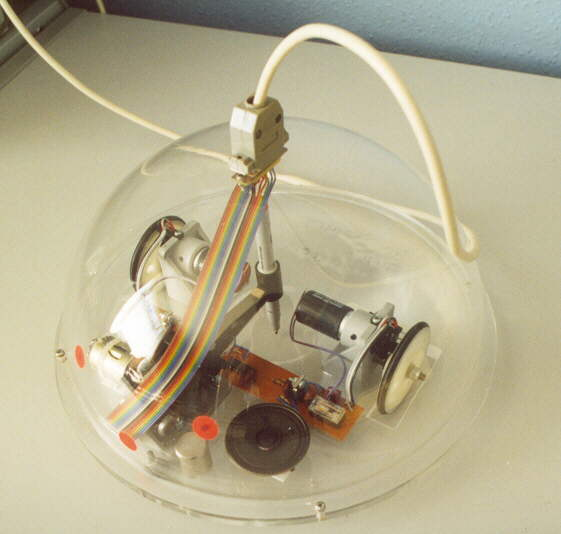
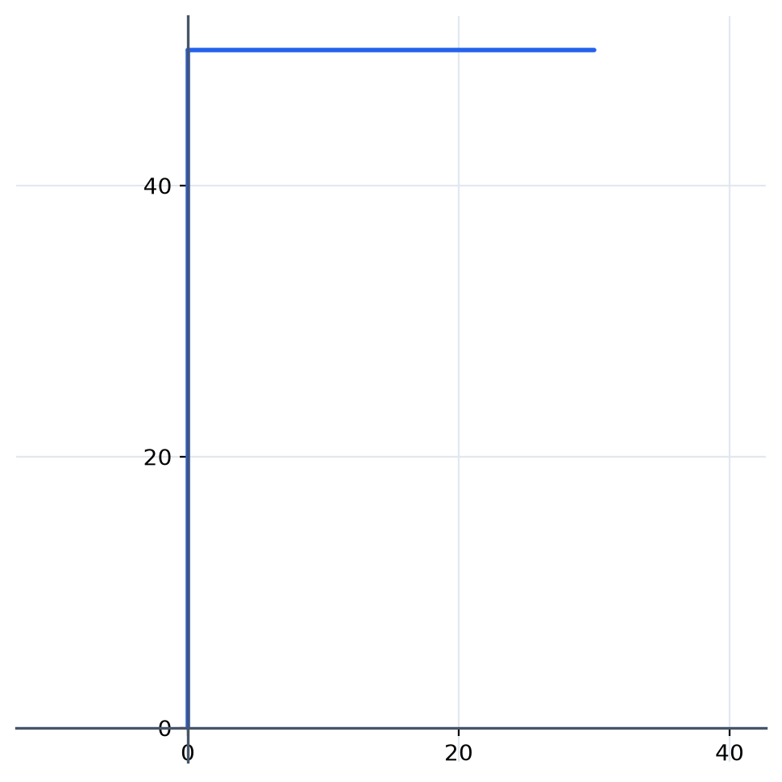
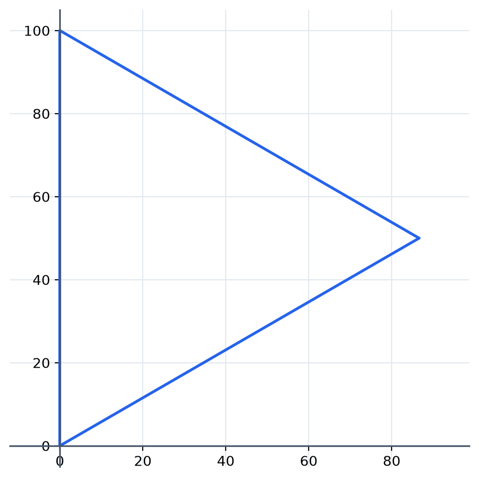

# Python Week 8 Workshop

---

#### Note on workshop attendance...

Remember that the assessment portfolio requires submissions from 6/8 workshops, and you must upload your work to the ELE assessed portfolio quiz before leaving the session.

---

Work in CodeSpaces.

You may use the following cheat sheets if you need to look up any Python commands.

- <https://github.com/phil-lewis-exe/PythonCheatSheets>
- [Python classes: cheat sheet](Cheatsheet.md) (for this week's workshop)

**This week try not to use other websites to help you code or translate the questions, as these won't be allowed in the graded workshops at the end of term.**

---

## Workshop on Python classes

The LOGO language was designed as an educational programming language for teaching coding. It allows you to control a "turtle" and use computer commands to draw shapes and patterns.

The turtle was originally a robot holding a pen that resembled a turtle in size, shape and speed.



A key use of these robot turtles was in primary schools, where pupils could learn to code and draw patterns by making use of concepts such as loops and procedures.

You may be surprised at the level of sophistication possible in these drawings (see examples at <https://turtletoy.net>).

In this workshop we will implement a simple class `PythonTurtle` to allow us to code a simple turtle drawing program.

The data attributes that the turtle object will store are:

| attribute | description |
|-----------|-------------|
| `title`   | stores a title for the turtle drawing we are making |
| `x`       | x-coordinate |
| `y`       | y-coordinate |
| `angle`   | direction (measured in degrees clockwise from North) |
| `path`    | list to store the coordinates visited by the turtle |

---

## Task 1

Work in GitHub Codespaces (the VS Code editor in your browser), and use the **Terminal** panel to run your code.

You will do each task in its own file (`week8_task1.py`, `week8_task2.py`, ...). At the start of each new task you will copy your previous file, so that you keep a record of how your code developed.

1. Create a new Python file and save it as `week8_task1.py`.
2. In this file define a class called `PythonTurtle`.
3. Add the class `__init__` constructor.

   This should take four extra arguments (after `self`) to provide the initial data attributes when initialising a `PythonTurtle` object:

   | argument | type    | default value |
   |----------|---------|---------------|
   | `title`  | `str`   |               |
   | `x`      | `float` | `0`           |
   | `y`      | `float` | `0`           |
   | `angle`  | `float` | `0`           |

   The remaining `self.path` attribute should be initialised to an empty list.

4. Below the class (not indented, so it is outside the class), add the test code below. It creates a turtle and checks its attributes.

   ```python
   turtle = PythonTurtle("task1", 0, 0, 180)

   print(f"-- TURTLE: {turtle.title} --")
   print(f"x: {turtle.x}")
   print(f"y: {turtle.y}")
   print(f"angle: {turtle.angle}")
   ```

5. Run it from the terminal:

   ```bash
   python week8_task1.py
   ```

   You should see:

   ```text
   -- TURTLE: task1 --
   x: 0
   y: 0
   angle: 180
   ```

> **For each of the following tasks:** copy your previous file to a new one (e.g. `cp week8_task1.py week8_task2.py` in the terminal, or copy and paste the file in the Explorer panel), then work in the new file. Add the new methods to the class, and replace the test code below the class with the test code for that task. Run the new file with `python week8_task2.py` etc.

---

## Task 2

Copy `week8_task1.py` to `week8_task2.py` and work in the new file.

Now add a `__str__` method to the `PythonTurtle` class so that you can use the `print` function to display the current turtle position.

It should display this information in the following way:

```text
-- TURTLE: task2 --
location: x = 0, y = 0
angle: 180
```

Note: you can build up the string line by line, e.g.

```python
def __str__(self):
    info_str = f"... \n"
    info_str += f"... \n"
    info_str += f"... "
    return info_str
```

Check your `__str__` method works by replacing the test code below the class with:

```python
turtle = PythonTurtle("task2", 0, 0, 180)
print(turtle)
```

---

## Task 3

Copy `week8_task2.py` to `week8_task3.py` and work in the new file.

We now want to add methods to let us control and move the turtle. Let's start with changing the direction that it is facing.

**a)** Add the following method to the class definition, which will rotate the turtle to the right (clockwise):

```python
def right(self, angle):
```

Within the method you should increase the current direction by the angle given, and print a message to the screen.

e.g. if the current value of `self.angle` is 45 and the user calls `.right(90)` then the new direction of the turtle will be 135 and the following message should be printed:

```text
turning right by 90 degrees
```

**b)** Next add the complementary method for rotating the turtle to the left (anti-clockwise):

```python
def left(self, angle):
```

Within the method you should decrease the current direction by the angle given.

e.g. if the current value of `self.angle` is 45 and the user calls `.left(90)` then the new direction of the turtle will be -45 and the following message should be printed:

```text
turning left by 90 degrees
```

**c)** Check your code works, for example by replacing the test code below the class with the code below and checking the output:

```python
turtle = PythonTurtle("task3", 0, 0, 60)
print(turtle)
print()

turtle.right(30)
print(turtle)
print()

turtle.left(50)
print(turtle)
print()
```

Output:

```text
-- TURTLE: task3 --
location: x = 0, y = 0
angle: 60

turning right by 30 degrees
-- TURTLE: task3 --
location: x = 0, y = 0
angle: 90

turning left by 50 degrees
-- TURTLE: task3 --
location: x = 0, y = 0
angle: 40

```

---

## Task 4

Copy `week8_task3.py` to `week8_task4.py` and work in the new file.

We now want to allow our turtle to move forward. To do this we need to work out the correct change to its x- and y-coordinates given the direction it is facing.

When the turtle moves forward a distance *d* when pointing in direction *a*, the change to the coordinates can be found using:

```text
x = x + d × sin(a)
y = y + d × cos(a)
```

where *a* is the angle in **radians**, which can be found for example using:

```python
a = math.radians(self.angle)
```

(You will need `import math` at the top of `week8_task4.py`.)

Use this formula to add a `.forward` method to the class definition:

```python
def forward(self, distance):
```

As well as updating the coordinates, it should print a message such as `moving forward by 50`.

> **Tip:** when printing the location in `__str__` you may want to show whole numbers, e.g. `{self.x:.0f}`, to avoid tiny rounding errors such as `6.1e-15`.

You can test your code by replacing the test code below the class with the code below and checking against the output:

```python
turtle = PythonTurtle("task4", 0, 0, 0)
print(turtle)
print()
turtle.forward(50)
turtle.right(90)
turtle.forward(30)
print()
print(turtle)
```

Output:

```text
-- TURTLE: task4 --
location: x = 0, y = 0
angle: 0

moving forward by 50
turning right by 90 degrees
moving forward by 30

-- TURTLE: task4 --
location: x = 30, y = 50
angle: 90
```

---

## Task 5

Copy `week8_task4.py` to `week8_task5.py` and work in the new file.

We can now move our turtle, but to be able to draw the path it has taken we need to store each position as the turtle moves forward.

Add a class method `.store_position()`. This can be defined within the class definition using:

```python
def store_position(self):
```

Inside this method your code should:

- make a tuple called `pos` that stores the current x and y coordinates
- append `pos` to the list stored by the `self.path` attribute

To make use of this method we can store the position using the code:

```python
self.store_position()
```

We need to do this

- at the point at which the turtle is created
- every time the turtle moves position

This means we must add a call to store the position as the final line in the `__init__` and `forward` class methods. When you have done this you can check the path history is correctly stored, e.g. by replacing the test code below the class with:

```python
turtle = PythonTurtle("task5", 0, 0, 0)
turtle.forward(50)
turtle.right(90)
turtle.forward(30)

print(turtle.path)
```

Output:

```text
moving forward by 50
turning right by 90 degrees
moving forward by 30
[(0, 0), (0.0, 50.0), (30.0, 50.0)]
```

---

## Task 6

Copy `week8_task5.py` to `week8_task6.py` and work in the new file.

Now that we can move and keep track of the turtle's path we can create an image.

Code to do this has been provided in the file [`path_helper.py`](path_helper.py). Copy this file into your code folder (the same folder as your `week8_task` files). In Codespaces you can create a new file called `path_helper.py` and paste in the code below.

<details>
<summary>Show <code>path_helper.py</code></summary>

```python
from matplotlib.collections import LineCollection
import matplotlib.pyplot as plt


def path_to_png(
    pathlist,
    filename="plot.png",
    grid_step=20,
    stroke="#2563eb",
    stroke_width=2,
    dpi=200,
):
    """
    Renders a list of two-point coordinates [((x1, y1), (x2, y2)), ...]
    onto a Cartesian (+) grid and saves directly to a PNG file.
    """
    fig, ax = plt.subplots(figsize=(6, 6))

    # 1. Plot all line segments at once
    if pathlist:
        lc = LineCollection(
            pathlist, colors=stroke, linewidths=stroke_width, capstyle="round"
        )
        ax.add_collection(lc)

    # 2. Centre the X and Y spines at (0, 0) to form a '+' coordinate system
    ax.spines["left"].set_position("zero")
    ax.spines["bottom"].set_position("zero")
    ax.spines["right"].set_visible(False)
    ax.spines["top"].set_visible(False)

    # Style the axis lines
    ax.spines["left"].set_color("#475569")
    ax.spines["bottom"].set_color("#475569")
    ax.spines["left"].set_linewidth(1.2)
    ax.spines["bottom"].set_linewidth(1.2)

    # 3. Configure equal aspect ratio, grid intervals, and auto-scaling
    ax.set_aspect("equal", adjustable="datalim")
    ax.xaxis.set_major_locator(plt.MultipleLocator(grid_step))
    ax.yaxis.set_major_locator(plt.MultipleLocator(grid_step))
    ax.grid(True, which="both", color="#e2e8f0", linestyle="-", linewidth=0.8)
    ax.set_axisbelow(True)  # Keep grid lines behind your path segments
    ax.autoscale_view()

    # 4. Save directly to PNG
    plt.savefig(filename, dpi=dpi, bbox_inches="tight", facecolor="white")
    plt.close(fig)  # Free memory after saving
```

</details>

This makes use of the `matplotlib` library. If you see an error when trying to import the code (e.g. `ModuleNotFoundError: No module named 'matplotlib'`) you can install it by running this in the terminal:

```bash
python -m pip install matplotlib
```

You are not expected to follow the code in this file, but you can make use of it to draw your turtle images. The function `path_to_png` takes a list of line segments, each one a pair of points, e.g.

```python
[((0, 0), (0, 50)), ((0, 50), (30, 50))]
```

and saves a picture of them to a PNG file.

To use the code add the following imports at the top of `week8_task6.py` (you may already have `import math` from Task 4):

```python
import math
from path_helper import path_to_png
```

Then add a `.draw` method to the class definition. It turns the stored path (a list of points) into a list of segments joining each point to the next one, and then draws them:

```python
def draw(self):
    filename = f"turtle_drawing_{self.title}.png"
    segments = list(zip(self.path, self.path[1:]))
    path_to_png(segments, filename)
    print(f"saved {filename}")
```

This allows you to save the current turtle drawing as an image. Replace the test code below the class with:

```python
turtle = PythonTurtle("task6", 0, 0, 0)
turtle.forward(50)
turtle.right(90)
turtle.forward(30)

turtle.draw()
```

will create the file `turtle_drawing_task6.png`. Click on it in the Codespaces **Explorer** panel to view it:



---

## Task 7

Copy `week8_task6.py` to `week8_task7.py` and work in the new file.

You can now test your class, e.g. replace the test code below the class with the following code, which draws a triangle:

```python
turtle = PythonTurtle("task7", 0, 0, 0)

turtle.forward(100)
turtle.right(120)
turtle.forward(100)
turtle.right(120)
turtle.forward(100)

turtle.draw()
```

It creates `turtle_drawing_task7.png`:



---

## Task 8

So far each file has contained both the class and the code that tests it. Normally a class lives in its own file so that any program can import and use it. Let's do that now.

1. Create a new file called `python_turtle.py`.
2. Copy into it everything from `week8_task7.py` **except** the test code below the class. That is, the imports at the top and the whole `PythonTurtle` class.
3. Copy `week8_task7.py` to `week8_task8.py`. Delete the imports and the class from `week8_task8.py` so that only the test code is left, and add this line at the top:

   ```python
   from python_turtle import PythonTurtle
   ```

4. Run `python week8_task8.py`. You should get the same triangle as in Task 7.

From now on, add new methods to `python_turtle.py` and use `week8_task8.py` (or new files like it) to try them out.

---

## Additional challenges

Add these to `python_turtle.py`:

- Add a method `.backward(self, distance)` use it to make a + shape drawing.
- Add a method `.goto(self, x, y)` that can be used to send the turtle to a given x, y coordinate. Use it to make a drawing of the letter W.
- Add a method `.rectangle(self, width, height)` that draws a rectangle of a given width and height.
- Add a method `.square(self, size)` that draws a square of a given size and draw an example picture.
- Add a method `.polygon(self, n_sides, size)` that draws a regular polygon of an shape.
- Add a method `.circle(self, radius)` that draws an (approximate?) circle path of a given radius, starting from the current position.
- Add a method `.spiral(self, n, stepsize)` that draws a spiral with the given number of rotations, which moves outwards by the stepsize as it travels.

**Hint** some of these methods can be reused. For example consider how a square is a special case for a rectangle, and as we increase the number of sides in a regular polygon the shape starts to resemble a circle.
